  
  &nbsp;&nbsp;&nbsp;
  

# reMESA

Hey! I'm Gama. I started with one old PowerVR GPU and somehow ended up with two. Welcome to reMESA: an independent effort to understand the SGX535 and SGX544 and eventually give them usable open graphics drivers.

Pipoca says hello too. She has witnessed an unreasonable amount of hexadecimal.

<table>
  <tr>
    <td width="100" valign="middle"></td>
    <td valign="middle"><strong>Pipoca:</strong> The Mini 12 can show a desktop, but that doesn't mean Linux has an open 3D driver for its GPU. That's why we're here.</td>
  </tr>
</table>

## Why are we doing this?

Intel Poulsbo machines can still display a Linux desktop, but `gma500` alone doesn't provide a modern open SGX 3D stack. The SGX544 has its own platform and driver history, including Android graphics components. Public programming information is limited for both. So I've been digging.

Both projects are here because I want to understand these chips and build open graphics support for them. That doesn't mean they speak the same language: their command formats and hardware interfaces need their own evidence, even when a general tool can be shared.

The SGX535 project started on September 16, 2026. Since then I've been studying historical drivers, compiler behavior and hardware captures, writing independent code, and testing on a Dell Mini 12. Some discoveries took hours. `0x07000345` took a lot longer. **ALWAYS.**

<table>
  <tr>
    <td width="100" valign="middle"></td>
    <td valign="middle"><strong>Pipoca:</strong> SGX535 is the one drawing on Gama's Mini 12. SGX544 is still at the research stage. Similar names don't make them the same GPU.</td>
  </tr>
</table>

| | SGX535 | SGX544 |
| --- | --- | --- |
| Architecture | PowerVR Series5, rev121 in the tested Mini 12 | PowerVR SGX544; its interfaces must be independently established |
| Devices and environment | Intel Poulsbo / GMA 500, Dell Mini 12, Linux | Android driver research; physical testing depends on access to suitable hardware |
| Maturity | Experimental Mesa/Gallium and kernel integration | Early reverse engineering, no independent working driver yet |
| Rendering | Physical GPU triangles, color/depth scenes and a restricted original GLXGears run | No independent GPU submission or framebuffer rendering demonstrated |
| Shaders | Restricted independent USSE/PDS work and NIR integration | GLSL-to-UniFlex compiler interface and UniPatch research; final encoder remains unresolved |
| Kernel | Experimental gma500/DRM, GEM and MMU work | No qualified kernel integration |
| Tests | Offline tests and documented Mini 12 physical qualifications | Research notes and testing plan; hardware execution not demonstrated |
| Limitations | General OpenGL, desktop acceleration and packaging remain incomplete | Compiler, command submission and hardware execution remain research |
| Code and notes | [Mesa](mesa/sgx535/), [kernel](kernel/remesa/), [documentation](docs/) | [SGX544 project](projects/sgx544/) |

## What actually worked on SGX535

<table>
  <tr>
    <td width="100" valign="middle"></td>
    <td valign="middle"><strong>Pipoca:</strong> Those triangles really came from the GPU! The whole desktop isn't accelerated yet, though. One triangle at a time.</td>
  </tr>
</table>

The Mini 12's SGX535 rev121 has rendered real triangles, and an OpenGL `glDrawArrays` call reached the GPU through the Gallium implementation. A qualified original `glxgears` run at 1280×800 completed 600 GPU submissions and averaged 16.1345 FPS across six measurement windows. The [physical results](docs/phase9/PHYSICAL-GLX-STATUS-20261027.md) describe the conditions; the [GLXGears guide](docs/reproduction/GLXGEARS.md) explains what is and isn't currently reproducible from a clone.

Later restricted scene tests covered color, depth and retirement at 640×640 and 1280×800. These results are exciting, but they do not establish OpenGL 2.1 conformance or an accelerated whole desktop. I keep CPU-only experiments and physical GPU evidence distinct because otherwise it gets very easy to celebrate the wrong triangle.

## The SGX544 side

<table>
  <tr>
    <td width="100" valign="middle"></td>
    <td valign="middle"><strong>Pipoca:</strong> The SGX544 library points to a GLSL compiler and UniFlex. Finding that signpost isn't the same as finding the road to a finished shader.</td>
  </tr>
</table>

The [SGX544 research](projects/sgx544/README.md) follows the original GLES shader compilation path, including dynamic loading of `libglslcompiler.so`, `GLSLCompileToUniflex` and parts of UniPatch. I've tried to make it clear in the notes what we actually observed and what we think might be happening. There's no working SGX544 renderer yet, and I can't just assume SGX535 command encodings will work on it.

The starting point was an Android driver archive, including an x86 32-bit GLES library. Static analysis traced `glCompileShader` to a compiler callback and the lookup of `GLSLCompileToUniflex`; it also found UniPatch setup. The matching compiler wasn't in that archive. Where UniFlex becomes final USSE, and how this device submits work and manages GPU memory, still need answers. See the [findings and their evidence limits](projects/sgx544/docs/FINDINGS.md).

Special thanks to **Incogninto** for sharing the Android driver binaries that made this investigation possible. The research repository does not redistribute those proprietary libraries.

## How the pieces fit

<table>
  <tr>
    <td width="100" valign="middle"></td>
    <td valign="middle"><strong>Pipoca:</strong> Mesa takes the OpenGL calls, and Gallium gives the driver the draws and state. Then Gama has to convince the GPU to do something with them.</td>
  </tr>
</table>

Mesa supplies the OpenGL frontend; Gallium provides an interface through which a driver receives draws, state and resources. The experimental SGX535 userspace builds hardware-facing state and shader programs, while the kernel side handles controlled access to memory and submission. GPU virtual addresses, ownership, synchronization and fences all matter here.

<table>
  <tr>
    <td width="100" valign="middle"></td>
    <td valign="middle"><strong>Pipoca:</strong> Submitting work means asking the GPU to run it. Fences help us wait; retirement tells us when the work is finished and resources can be released safely. A command that looks good on the CPU hasn't drawn anything yet.</td>
  </tr>
</table>

GEM manages graphics buffers on the kernel side, and the GPU MMU maps the addresses used by the GPU. The implementation has to keep those mappings and their owners valid while work is in flight; getting the pixels right once isn't enough if the next draw uses freed memory.

USSE is the shader instruction architecture being investigated. PDS programs participate in preparing and delivering data and tasks to the GPU. GLSL and UniFlex belong to compiler paths studied in the original software; their exact relationship to final instructions must be established from evidence. These terms are not interchangeable, and neither are the two GPUs' encodings.

## Where to look

- [`mesa/sgx535/`](mesa/sgx535/) and [`kernel/remesa/`](kernel/remesa/) contain the current SGX535 implementation; [`common/remesa/`](common/remesa/) holds shared code already used by it.
- [`docs/`](docs/) contains development notes, physical evidence and [reproduction guides](docs/reproduction/). [The previous SGX535 README](docs/history/README-SGX535-20261105.md) preserves the project story and acknowledgments.
- [`projects/sgx544/`](projects/sgx544/) preserves the SGX544 README, notes, tools and test materials in their original relative layout. Its upstream history is [available separately](https://github.com/reMESA-devgroup/SGX544-reMESA), including the imported revision `a3398a5a2ccc03b7778932219ccb2ea71aa950cc`.
- [`tools/`](tools/) and [`checkpoints/`](checkpoints/) include existing tests and historical artifacts. Follow each guide's prerequisites; physical experiments are hardware-specific and some private test bundles are not published.

For now, I'm keeping hardware-specific code separate. Both names start with SGX, but that's not enough reason to make them share a backend.

## Next steps and contributing

<table>
  <tr>
    <td width="100" valign="middle"></td>
    <td valign="middle"><strong>Pipoca:</strong> Next up: more draws, textures and shaders. And eventually a desktop with actual applications. No pressure, Gama.</td>
  </tr>
</table>

For **SGX535**, the next steps are general Mesa draws, textures, shaders and resource lifetime, followed by broader OpenGL coverage, a responsive accelerated desktop and application testing. OpenGL ES 2.0, desktop OpenGL 2.1, video acceleration and an installable beta are goals, not finished features.

For **SGX544**, I need to understand more of the compiler and hardware interfaces, then establish memory and submission contracts before attempting independent GPU execution and verified readback on physical hardware. The [research roadmap](projects/sgx544/docs/ROADMAP.md) has the details. No pretend triangles.

<table>
  <tr>
    <td width="110" valign="middle">
      
    </td>
    <td valign="middle">
      Have compatible hardware, references, test results or driver experience?
      Issues and contributions are welcome. Please include the device,
      kernel, commands and evidence, and tell us whether the result was
      CPU-only or ran on the GPU. Keep track of where material came from,
      and please don't contribute proprietary driver code or binaries
      unless you have the right to redistribute them.
    </td>
  </tr>
</table>

Thanks to Simon Fenney, e1zo, Alex (Poulsback), Garnet, monocasa, nicman24, intelminer, Incogninto, everyone sharing evidence, and of course Pipoca. The [original README](docs/history/README-SGX535-20261105.md) has the full thanks and more of the story.

<table>
  <tr>
    <td width="110" valign="middle">
      
    </td>
    <td valign="middle">
      The goal is serious. The documentation doesn't always have to be.
       
       
      — Gama
    </td>
  </tr>
</table>
